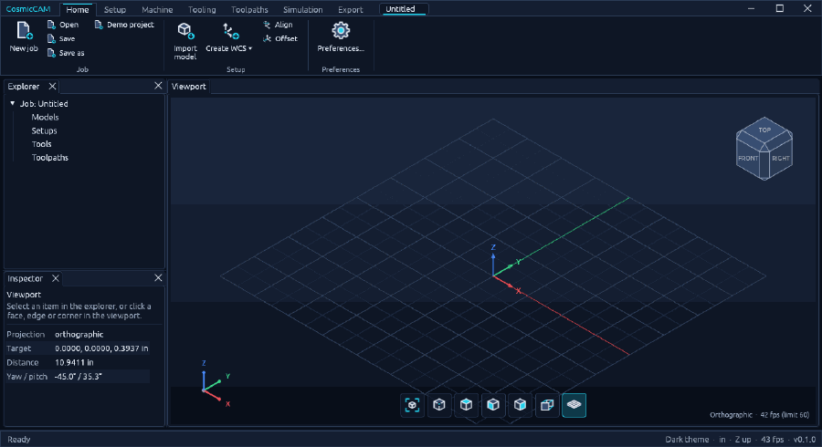

# CosmicCAM

CosmicCAM is an open-source, pure-Rust **Computer-Aided Manufacturing (CAM)** application. It is
being built to turn CAD geometry (B-Rep models, meshes and 2D boundaries) into CNC toolpaths,
material-removal simulations and machine-specific G-code. Everything it does can be driven from
Python.



*A new job, start to finish: import a model, create a WCS from a face and an edge, create a
setup with fitted stock, then a 2D contour around the part and 3D roughing of the stock.*

## Where the project is

**Early development.** Phases 1 and 3 are complete, and Phase 2 is complete apart from STEP/IGES
import. CosmicCAM imports models, defines WCS, setups, stock, machines and tools, makes 2.5D and
3D toolpaths (with 3+2 and simultaneous 4/5-axis work), simulates the stock removal and posts
G-code for Fanuc, Haas, LinuxCNC, Grbl and Mach controls. The posts follow published controller documentation and there is no full machine
simulation yet, so **check its G-code before running it on a machine**.

| Phase | Milestone | Status |
| --- | --- | --- |
| 1 | Desktop UI & theme engine | **Done** |
| 2 | Model import & geometry ingestion (STL/OBJ, STEP/IGES) | **Done except STEP/IGES** |
| 3 | Work coordinate system (WCS) creation | **Done** |
| 4 | Tool library & management | **In progress** |
| 5 | Stock setup & material definition | **In progress** (setups, box stock) |
| 6 | Toolpath creation (2.5D, 3-axis and multi-axis strategies) | **In progress** (contour, face, pocket, drill, 3D rough, waterline, raster, 3+2, multi-axis finish) |
| 7 | Material-removal simulation & verification | **In progress** (height-field and voxel stock simulation, gouge and collision checks) |
| 8 | Post-processors & G-code export | **In progress** (Python posts for five controllers, arc fitting, limits, 4/5-axis output) |
| 9 | MCP agent integration | Planned |
| 10 | Scripting & add-ons | Planned |
| 11 | VS Code integration & extension | Planned |

### What works today
- **Desktop app** (eframe + wgpu):
  - A ribbon with Home, Setup, Machine, Tooling, Toolpaths, Simulation and Export tabs and original
    icons; the tab strip doubles as the title bar, with document tabs and the window controls.
  - Viewport, Explorer, Inspector and Console panes you can drag, stack and resize.
  - A dark theme (default) and a high-contrast light theme, chosen in Preferences.
- **Model import:** binary and ASCII STL and Wavefront OBJ, from the Import model button
  (Ctrl+I), drag-and-drop onto the window or `model.import` in scripts. Files are read in mm,
  cm, m or inches.
- **Setups and stock:** Create setup names a setup and picks its machine, WCS (or the origin) and
  stock: fitted to the model with margins, a fixed size, or two corners, rounded up if wanted, and
  shown see-through while it is defined.
- **Toolpaths:** 2D contour, Face, Pocket (with islands), Drill (canned cycles: drill, spot,
  peck, chip break, tap, bore), 3D rough, Waterline, Raster and Multi-axis finish, each set up in
  the toolpath panel with a live preview. Raster also takes ball end mills; the other 3D
  strategies use flat end mills for now.
- **2D contour:** follow edges or a face outline at depth with radial and axial
  passes, stock to leave, leads, ramps, feed optimization, an entry point and a tolerance that
  follows true circles; set up in a panel with a live preview.
- **Simulation:** play the program against the stock in machine time (Simulation tab, or Space),
  scrub, step and change speed; gouge check (cuts below the part, shown in red) and collision
  check (rapids through material, cuts deeper than the flutes, the shank rubbing). A height field
  for one tool axis, voxels when the tool tilts; flat and ball end mills.
- **Explorer:** right-click any item to edit, show/hide, rename, copy, paste, duplicate or
  delete it; an eye beside each toolpath and model shows or hides it (only the selected toolpath
  is drawn otherwise).
- **Demo project:** the app opens with a ready-made job to try things on (Home → Demo project).
- **Job files:** save and open jobs as `.cosmic` files, each open job in its own tab, carrying the
  tools their toolpaths use; on Linux,
  `packaging/linux/install-file-type.sh` gives `.cosmic` files their own icon and opens them in
  CosmicCAM.
- **Post-processors:** Python posts for Fanuc, Haas, LinuxCNC/PathPilot, Grbl and Mach3/Mach4
  (or the built-in generic writer), chosen per machine on the Export tab: arcs (G2/G3, helical)
  fitted within a tolerance, each controller's work offsets, canned cycles, tool changes and
  coolant codes, limit checks. Each post's settings (sequence numbers, tool preselect and
  change position, restart-safe operations, LinuxCNC G64 blending, G33.1 rigid tapping, M64/M65
  coolant outputs, o-word subroutines…) are edited in the Post-processor dialog and kept per
  machine; a toolpath's Post tab adds a stop, an operator note and pass-through G-code. Write your
  own: see [docs/posts.md](docs/posts.md).
- **4- and 5-axis:** machines with rotary axes (trunnion, head-table or head-head, A/B/C with
  travel and centres); 3+2 work on any strategy by picking a tilted WCS as its orientation; a
  Multi-axis finish whose ball end mill tilts as it follows the surface, leaning back where the
  shank would touch; voxel simulation of tilting tools; posts write tilted planes (G68.2, G254),
  tool centre point control (G43.4, G234) or the machine's own positions with inverse-time feeds.
- **Units:** inches (default) or millimetres everywhere in the app, from Preferences on the Home tab;
  scripts and the API always use millimetres.
- **Machines and tools:** several machine configurations, each with its own tool library of flat
  and ball end mills (geometry, cutting data, offsets), saved automatically; import and export as JSON.
- **Work coordinate systems:** create, place on the part (top centre, corners…), offset,
  rotate and align WCS, setting each axis and the origin by clicking faces and edges (planes,
  holes, edges, corners, box points); the active one is drawn in full colour in the viewport.
- **3D viewport:**
  - Shaded models with feature edges, stock outline, ground grid and a WCS marker.
  - A chamfered view cube (click any face, edge or corner for that view), a row of view buttons at
    the bottom of the viewport, and a corner orientation marker.
  - Orthographic and perspective projection, smooth camera moves and a frame-rate limit.
  - Orbit with left-drag, pan with middle/right-drag or Shift+drag, zoom with the wheel about the cursor.
- **Everything is a command:** the ribbon, console, shortcuts, scripts and the Python API all run
  the same 145 commands. Each command has a typed parameter schema that the engine checks before
  running it.
- **Python API:** a stdlib-only client (`python/cosmiccam`) drives the running app over a
  token-protected localhost control channel.
- **Robustness:**
  - Commands run under a panic guard that restores the session if one fails.
  - Hostile parameters are tested against every command.
  - There is no `unwrap`/`panic` in production code.

### Placeholders
Commands for later phases (cylinder stock, more tool types, simulation,
post-processing)
already appear in the ribbon and the API. They are disabled and report "not available yet" so the
full surface is visible and scriptable ahead of time.

## In the browser

CosmicCAM also runs as a web app (`apps/CosmicCAM-web`): the same application compiled to
WebAssembly, drawing with WebGPU, or WebGL 2 where WebGPU is not available. Import models
with the Import button or by dropping files on the page; everything stays in the browser.
The Python control channel and window screenshots are desktop-only.

```bash
rustup target add wasm32-unknown-unknown
cargo install --locked trunk
cd apps/CosmicCAM-web
trunk serve --open                     # local build at http://127.0.0.1:8080
trunk build --release                  # static site in apps/CosmicCAM-web/dist
```

`.github/workflows/pages.yml` builds it on every push to `main` and publishes it to GitHub
Pages. To turn that on, set **Settings → Pages → Source** to **GitHub Actions**.

## Getting started

You need Rust 1.88+ and a GPU with Vulkan, Metal or DirectX 12. Python 3.9+ is only needed for the API.

```bash
cargo run --release -p CosmicCAM
```

While CosmicCAM is in pre-release it opens with a **demo project** (`samples/demo.cosmic`): a
part with a pocket and a boss, a WCS, a setup with its stock, two tools and five toolpaths (face,
3D rough, pocket, waterline and a profile), ready to inspect, change and post. Reopen it any time
with **Demo project** on the Home tab; its tools are added to your library if they are missing.

| Option | Effect |
| --- | --- |
| `--empty` | Start with an empty job instead of the demo project |
| `--sample` | Open with the simple built-in sample part instead |
| `--control <port>` | Open the control channel for the Python API (`0` picks a free port) |
| `--run "<command> <json>"` | Run a command after start-up (repeatable) |
| `--tab <name>` | Open on a ribbon tab |
| `job.cosmic` | Open a job file (each in its own tab) |
| `--screenshot <file.png>` | Save a window capture once start-up steps have run, then quit |

The console pane accepts the same commands, e.g. `view.camera.preset {"preset": "top"}`.

## Python API

```bash
pip install -e python/
```

```python
import cosmiccam

with cosmiccam.launch(sample=True) as cc:      # starts the app; quits it on exit
    cc.view_theme_set(theme="light")
    cc.view_camera_set(yaw=-60, pitch=25)
    cc.view_fit()
    print(cc.state()["camera"])
    cc.screenshot("view.png")
```

- [docs/api/python.md](docs/api/python.md) is the API guide: every command with its parameters
  and return value. It's generated from the command registry and kept in sync by CI.
- [docs/control-protocol.md](docs/control-protocol.md) documents the wire protocol underneath.
- [python/examples/tour.py](python/examples/tour.py) is a runnable tour.

## Repository layout

| Path | Contents |
| --- | --- |
| `crates/geom` | L0 — vectors, bounding boxes (millimetres, Z up) |
| `crates/render` | L1 — orbit camera, scene buffers, view-cube geometry (no GPU code) |
| `crates/engine` | L4 — session, command registry and parameter schemas |
| `crates/ui-egui` | L5 — theme, ribbon, dock, wgpu viewport, icons, control channel |
| `apps/CosmicCAM` | The desktop application |
| `xtask` | Repository checks and generators (`cargo xtask …`) |
| `python/` | The `cosmiccam` Python client, its tests and examples |
| `assets/icons/ui` | Icon SVG masters and the icon style guide |
| `docs/` | API guide and control protocol |

Lower layers never depend on higher ones or on UI crates. Everything below the UI builds for
WebAssembly. Both rules are checked by `cargo xtask layers` and `cargo xtask wasm`.

## Development

```bash
cargo xtask ci     # fmt, clippy -D warnings, tests, assets, layers, ui-containers,
                   # API/guide freshness, Python tests, wasm
cargo xtask api    # regenerate the Python API and guide after changing commands
```

Every new feature ships as engine commands with typed parameters, in the Python API, and in the
API guide. CI fails if the generated API is stale. Contributor and agent rules, including the
no-panic policy, clean-room independence and asset licensing, are in [AGENTS.md](AGENTS.md).
Progress is tracked in [ROADMAP.md](ROADMAP.md).

## Licence

Licensed under either of [Apache License, Version 2.0](LICENSE-APACHE) or [MIT licence](LICENSE-MIT)
at your option. Unless you explicitly state otherwise, any contribution you submit for inclusion
in CosmicCAM is dual licensed as above, without additional terms.

All icons and artwork are original. Third-party code and assets are listed in
[ATTRIBUTION.md](ATTRIBUTION.md).
