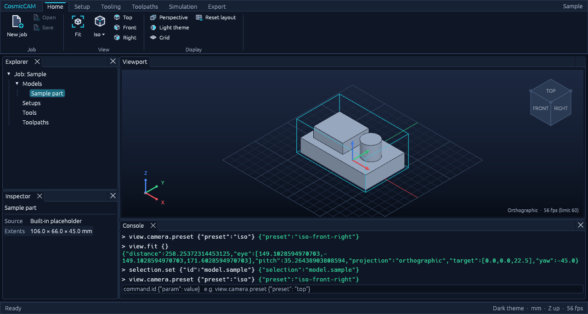

# CosmicCAM

CosmicCAM is an open-source, pure-Rust **Computer-Aided Manufacturing (CAM)** application. It is
being built to turn CAD geometry (B-Rep models, meshes and 2D boundaries) into CNC toolpaths,
material-removal simulations and machine-specific G-code. Everything it does can be driven from
Python.



*Current state: the desktop shell with ribbon, dockable panes and the wgpu 3D viewport, showing
the built-in sample part. STL and OBJ models can now be imported.*

## Where the project is

**Early development.** Phases 1 and 3 are complete, and Phase 2 is complete apart from STEP/IGES import. CosmicCAM can't machine
anything yet: it imports STL and OBJ models, but there is no tooling, toolpath generation or
G-code output so far.

| Phase | Milestone | Status |
| --- | --- | --- |
| 1 | Desktop UI & theme engine | **Done** |
| 2 | Model import & geometry ingestion (STL/OBJ, STEP/IGES) | **Done except STEP/IGES** |
| 3 | Work coordinate system (WCS) creation | **Done** |
| 4 | Tool library & management | **In progress** |
| 5 | Stock setup & material definition | Planned |
| 6 | Toolpath creation (2.5D and 3-axis strategies) | Planned |
| 7 | Material-removal simulation & verification | Planned |
| 8 | Post-processors & G-code export | Planned |
| 9 | MCP agent integration | Planned |

### What works today
- **Desktop app** (eframe + wgpu):
  - A ribbon with Home, Setup, Tooling, Toolpaths, Simulation and Export tabs, and 40 original icons.
  - Viewport, Explorer, Inspector and Console panes you can drag, stack and resize.
  - A dark theme (default) and a high-contrast light theme.
- **Model import:** binary and ASCII STL and Wavefront OBJ, from the Import model button
  (Ctrl+I), drag-and-drop onto the window or `model.import` in scripts. Files are read in mm,
  cm, m or inches.
- **Units:** inches (default) or millimetres everywhere in the app, from Settings on the Home tab;
  scripts and the API always use millimetres.
- **Machines and tools:** several machine configurations, each with its own tool library of flat
  end mills (geometry, cutting data, offsets), saved automatically; import and export as JSON.
- **Work coordinate systems:** create, place on the part (top centre, corners…), offset,
  rotate and align WCS, setting each axis and the origin by clicking faces and edges (planes,
  holes, edges, corners, box points); the active one is drawn in full colour in the viewport.
- **3D viewport:**
  - Shaded models with feature edges, stock outline, ground grid and a WCS marker.
  - A clickable view cube with a column of view buttons under it, and a corner orientation marker.
  - Orthographic and perspective projection, smooth camera moves and a frame-rate limit.
  - Orbit with left-drag, pan with middle/right-drag or Shift+drag, zoom with the wheel about the cursor.
- **Everything is a command:** the ribbon, console, shortcuts, scripts and the Python API all run
  the same 111 commands. Each command has a typed parameter schema that the engine checks before
  running it.
- **Python API:** a stdlib-only client (`python/cosmiccam`) drives the running app over a
  token-protected localhost control channel.
- **Robustness:**
  - Commands run under a panic guard that restores the session if one fails.
  - Hostile parameters are tested against every command.
  - There is no `unwrap`/`panic` in production code.

### Placeholders
Commands for later phases ( stock, tools, toolpaths, simulation, post-processing)
already appear in the ribbon and the API. They are disabled and report "not available yet" so the
full surface is visible and scriptable ahead of time.

## In the browser

CosmicCAM also runs as a web app (`apps/CosmicCAM-web`): the same application compiled to
WebAssembly, drawing with WebGPU, or WebGL 2 where WebGPU is not available. Import models
with the Import button or by dropping files on the page; everything stays in the browser.
The Python control channel and window screenshots are desktop-only.

```bash
rustup target add wasm32-unknown-unknown
cargo install --locked trunk
cd apps/CosmicCAM-web
trunk serve --open                     # local build at http://127.0.0.1:8080
trunk build --release                  # static site in apps/CosmicCAM-web/dist
```

`.github/workflows/pages.yml` builds it on every push to `main` and publishes it to GitHub
Pages. To turn that on, set **Settings → Pages → Source** to **GitHub Actions**.

## Getting started

You need Rust 1.88+ and a GPU with Vulkan, Metal or DirectX 12. Python 3.9+ is only needed for the API.

```bash
cargo run --release -p CosmicCAM -- --sample
```

| Option | Effect |
| --- | --- |
| `--sample` | Open with the built-in sample part |
| `--control <port>` | Open the control channel for the Python API (`0` picks a free port) |
| `--run "<command> <json>"` | Run a command after start-up (repeatable) |
| `--tab <name>` | Open on a ribbon tab |
| `--screenshot <file.png>` | Save a window capture once start-up steps have run, then quit |

The console pane accepts the same commands, e.g. `view.camera.preset {"preset": "top"}`.

## Python API

```bash
pip install -e python/
```

```python
import cosmiccam

with cosmiccam.launch(sample=True) as cc:      # starts the app; quits it on exit
    cc.view_theme_set(theme="light")
    cc.view_camera_set(yaw=-60, pitch=25)
    cc.view_fit()
    print(cc.state()["camera"])
    cc.screenshot("view.png")
```

- [docs/api/python.md](docs/api/python.md) is the API guide: every command with its parameters
  and return value. It's generated from the command registry and kept in sync by CI.
- [docs/control-protocol.md](docs/control-protocol.md) documents the wire protocol underneath.
- [python/examples/tour.py](python/examples/tour.py) is a runnable tour.

## Repository layout

| Path | Contents |
| --- | --- |
| `crates/geom` | L0 — vectors, bounding boxes (millimetres, Z up) |
| `crates/render` | L1 — orbit camera, scene buffers, view-cube geometry (no GPU code) |
| `crates/engine` | L4 — session, command registry and parameter schemas |
| `crates/ui-egui` | L5 — theme, ribbon, dock, wgpu viewport, icons, control channel |
| `apps/CosmicCAM` | The desktop application |
| `xtask` | Repository checks and generators (`cargo xtask …`) |
| `python/` | The `cosmiccam` Python client, its tests and examples |
| `assets/icons/ui` | Icon SVG masters and the icon style guide |
| `docs/` | API guide and control protocol |

Lower layers never depend on higher ones or on UI crates. Everything below the UI builds for
WebAssembly. Both rules are checked by `cargo xtask layers` and `cargo xtask wasm`.

## Development

```bash
cargo xtask ci     # fmt, clippy -D warnings, tests, assets, layers, ui-containers,
                   # API/guide freshness, Python tests, wasm
cargo xtask api    # regenerate the Python API and guide after changing commands
```

Every new feature ships as engine commands with typed parameters, in the Python API, and in the
API guide. CI fails if the generated API is stale. Contributor and agent rules, including the
no-panic policy, clean-room independence and asset licensing, are in [AGENTS.md](AGENTS.md).
Progress is tracked in [ROADMAP.md](ROADMAP.md).

## Licence

Licensed under either of [Apache License, Version 2.0](LICENSE-APACHE) or [MIT licence](LICENSE-MIT)
at your option. Unless you explicitly state otherwise, any contribution you submit for inclusion
in CosmicCAM is dual licensed as above, without additional terms.

All icons and artwork are original. Third-party code and assets are listed in
[ATTRIBUTION.md](ATTRIBUTION.md).
